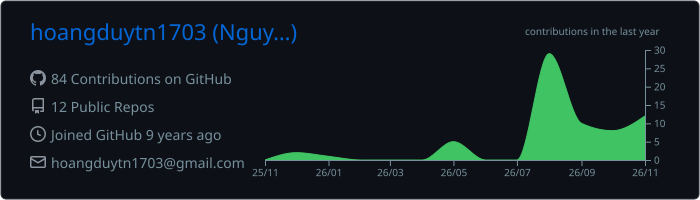
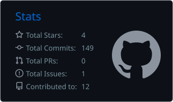
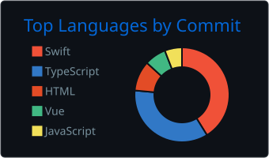

<h1 align="center">Hi there, I'm Duy 👋</h1>

  

  
  
  
  

## 🧑‍💻 About me

- 🎯 Front-end developer based in **Hồ Chí Minh City, Việt Nam**
- ⚛️ Mostly working with **React, Next.js, Vue** and **TypeScript**
- ✨ Love smooth UI — motion, responsive layouts and the little details
- 🌱 Always tinkering with side projects: web apps, small tools and mini games
- 📫 Reach me at **hoangduytn1703@gmail.com**

## 🛠️ Tech stack

**Front-end**

  

**Back-end & tools**

  

## 📊 GitHub stats

  

  
  

  <picture>
    <source media="(prefers-color-scheme: dark)" srcset="https://streak-stats.demolab.com?user=hoangduytn1703&theme=github-dark-blue&hide_border=true&disable_animations=true" />
    
  </picture>

## 🐍 Contribution snake

<picture>
  <source media="(prefers-color-scheme: dark)" srcset="https://raw.githubusercontent.com/hoangduytn1703/hoangduytn1703/output/github-snake-dark.svg" />
  <source media="(prefers-color-scheme: light)" srcset="https://raw.githubusercontent.com/hoangduytn1703/hoangduytn1703/output/github-snake.svg" />
  
</picture>
